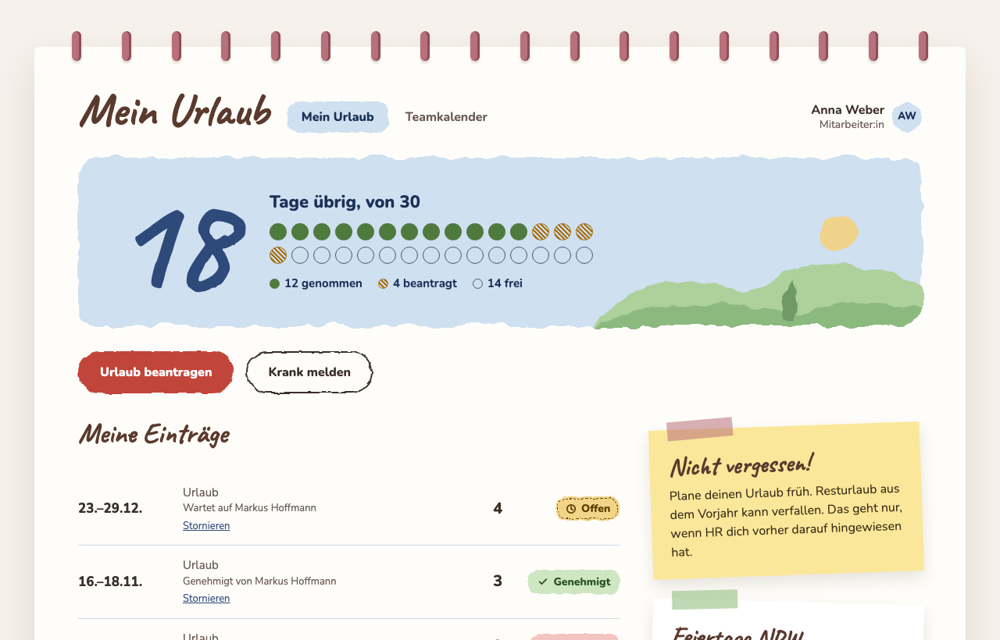
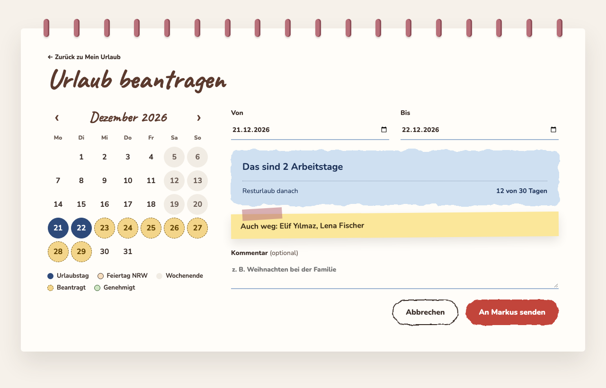
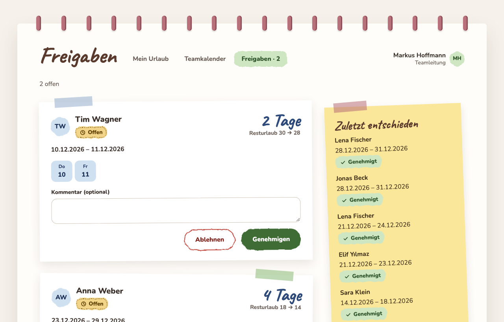
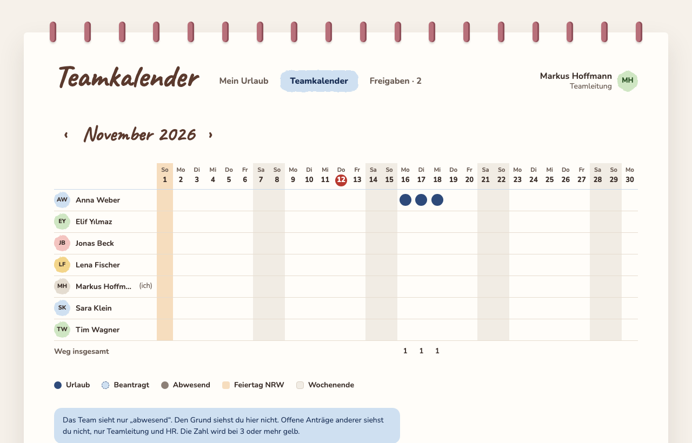
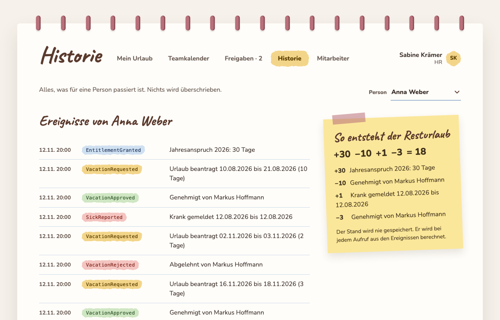
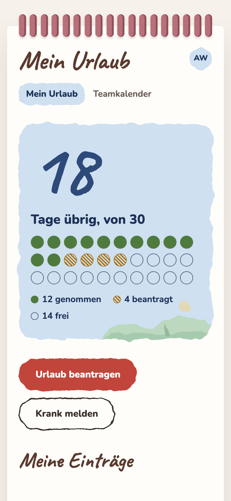
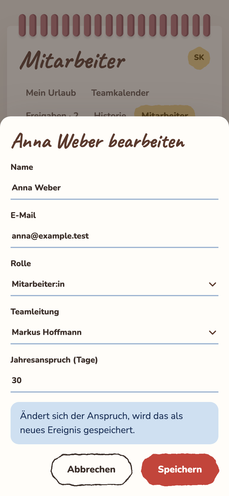

# Wegbuch

A small absence tool for a team: request vacation, report sick, approve, see who is away.
German UI, German (NRW) rules. A prototype built for a review at LOX Solutions, Cologne.

<table>
  <tr>
    <td width="50%"><br><sub><b>Mein Urlaub</b>: the balance at a glance</sub></td>
    <td width="50%"><br><sub><b>Request</b>: live count of working days, and who else is away</sub></td>
  </tr>
  <tr>
    <td><br><sub><b>Freigaben</b>: the lead decides with one click</sub></td>
    <td><br><sub><b>Teamkalender</b>: colleagues only see "abwesend", never the reason</sub></td>
  </tr>
  <tr>
    <td><br><sub><b>Historie</b> (HR): every number can be explained</sub></td>
    <td align="center"> <br><sub><b>On a phone</b>: dialogs are bottom sheets</sub></td>
  </tr>
</table>

## What it does

- **Employees** see their remaining days, request vacation (working days and public holidays are counted for them), and report sick.
- **Team leads** approve or reject, and see who else is away. **HR** sees everything, adds and deactivates people, and has the full history.
- **Sick leave stays private:** only HR sees "krank". Everyone else sees "abwesend".
- **Live:** when something changes, the pages of the people it concerns update by themselves.

## Run it

Needs Node 24 (`nvm use`).

```sh
bun install
bun dev          # http://localhost:5173, with demo accounts and demo data
bun run check    # types and Svelte checks
bun run test     # unit tests
```

In demo mode the login page has one-click buttons for Anna (employee), Markus (lead) and Sabine (HR).
The database is one SQLite file (`data/absence.db`, or `DATABASE_PATH`). Delete it and restart for fresh demo data.

## How it is built

- **SvelteKit 3**, TypeScript, remote functions for all data and forms. Only runtime dependency: `valibot`.
- **Append-only event log** in SQLite. A balance is never stored, it is computed from the events. Writes are checked by version and an idempotency key.
- `src/core` pure rules (no I/O), `src/lib/server` services around SQLite, `src/core/constants.ts` every limit and timeout in one file.
- Own login (argon2id, hashed session secrets), three roles.
- `/coming-soon` has preview videos of ideas that are not built. It is not in the navigation on purpose.

## Deploy

```sh
bun run deploy            # check, test, build, upload, restart, verify
bun run deploy status     # what runs, and which commit
bun run deploy reset      # wipe the demo data now (demo mode re-seeds on start)
```

Host and address go into `.env.deploy` (git ignores it, `.env.example` shows the format).
Production needs HTTPS (the session cookie is `Secure`) and builds with `ORIGIN=https://<address>`.
The first HR account comes from `ADMIN_EMAIL` and `ADMIN_PASSWORD`, and only while the database is empty. Demo accounts only exist with `DEMO=1`, never set it on a real site.
Keep the `data/` folder across deployments. One process only (the live counters are in memory).

## Known gaps (a prototype, on purpose)

- **Data:** no backup yet, no schema versioning, `node:sqlite` is a release candidate, one database for everyone.
- **Security:** login throttle is per email, one-time passwords never expire, session timeouts are lenient (12 h idle), no log of HR actions, only a minimal CSP.
- **Rules:** no leave expiry or carryover (German law needs a documented employer notice), sick days inside a vacation are credited without a certificate, no company calendar (Rosenmontag counts as a working day), no half days.
- **Product:** no invite links, SSO, SCIM or chat integrations, no DSGVO erasure (comments sit inside events), phone navigation could be a bottom bar.
- **Tooling:** `remoteFunctions` and Svelte `async` are experimental. Pin versions before relying on it.
